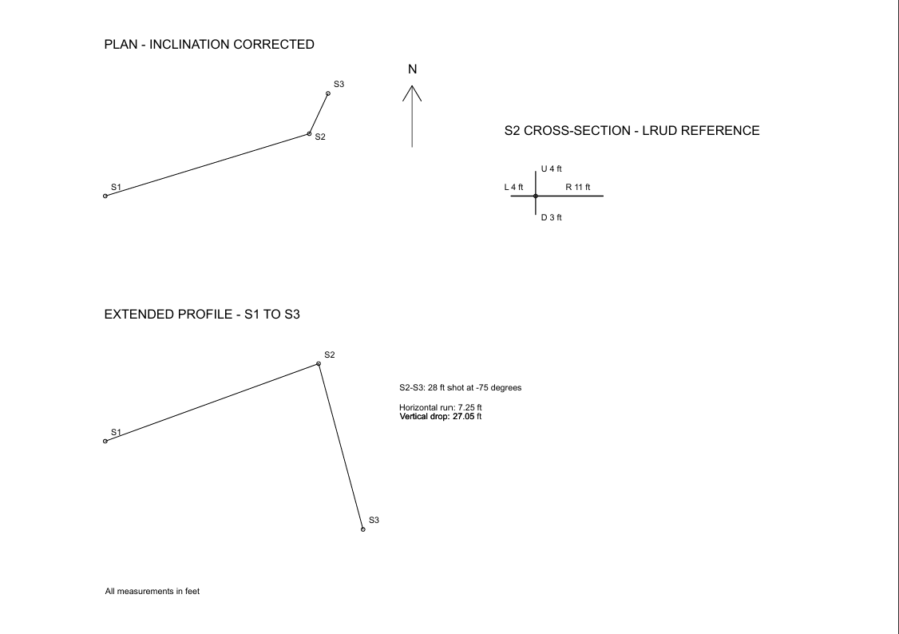

# qCAD Cave Surveying

A personal cave surveying project connecting my hobby involvement with Central Arizona Grotto (CAG) to CAD drafting. This project translates handwritten survey notes into an editable drawing and a printable reference sheet using QCAD.

## From field notes to CAD

The source pages document several stages of the same survey exercise: a rough plan without inclination correction, supporting trigonometry, and a profile sketch.

The drafting work uses the recorded shot lengths, azimuths, and inclinations to construct an inclination-corrected S1–S3 plan and an extended profile. The steep S2–S3 shot illustrates why this matters: a 28 ft measurement at −75° represents approximately **7.25 ft of horizontal travel** and **27.05 ft of vertical drop**.

## Deliverables

 
- [Editable DXF drawing](cave_survey.dxf)
- [Printable PDF sheet](cave_survey.pdf)
- [Handwritten source notes and calculations](images/)

The drawing includes an inclination-corrected plan, an extended profile, station markers and labels, a north arrow, and an S2 left/right/up/down (LRUD) reference.

## Survey data used

| Shot | Length | Azimuth | Inclination |
|---|---:|---:|---:|
| S1 → S2 | 37 ft | 73° | +20° |
| S2 → S3 | 28 ft | 25° | −75° |

The S2 LRUD measurements are **4 ft left, 11 ft right, 4 ft up, and 3 ft down**.

All measurements are in feet. The plan uses a local origin at S1, with east as positive X and north as positive Y. Azimuths are measured clockwise from north.

## Drafting approach

For each shot, the horizontal distance is calculated from the measured length and inclination:

H = L × cos(C)

The horizontal distance is then resolved into east and north components:

ΔE = H × sin(A)  
ΔN = H × cos(A)

Elevation change is calculated as:

ΔZ = L × sin(C)

The extended profile plots cumulative horizontal distance against elevation change, using equal horizontal and vertical scales. It is offset below the plan for sheet layout.

Separate layers organize centerlines, station markers, labels, and the LRUD reference.

## Scope and limitations

This drawing reconstructs the available notes; it is not a complete cave map or an independently verified survey.

- S3–S4 is recorded in the notes but omitted because its inclination is missing.
- The S2 LRUD cross represents recorded distances from the station, rather than a surveyed passage outline.
- Passage walls and formations have not been inferred from the sketches.
- Coordinates are local and are not georeferenced.
- No loop closure or magnetic declination adjustment has been applied.

Here, “inclination corrected” means that slope distances have been reduced to horizontal distances for the plan.

## Next steps

- Recover the missing S3–S4 inclination and extend the drawing.
- Transcribe the source measurements into a structured data table.
- Add passage detail where supported by additional measurements and sketches.
- Add a scale bar and document the north reference.
- Compare the drafted coordinates with an independent survey calculation.

## Personal context

This is an independent learning and portfolio project informed by my interest in caving and involvement with Central Arizona Grotto. It is not an official CAG survey product.